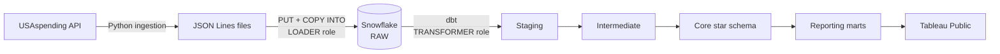

# Public Infrastructure Analytics

[](https://github.com/Tejas14Feb/public-infrastructure-analytics/actions/workflows/pipeline.yml)
[](https://github.com/Tejas14Feb/public-infrastructure-analytics/actions/workflows/deploy.yml)
[](https://github.com/Tejas14Feb/public-infrastructure-analytics/actions/workflows/ci.yml)

An end-to-end analytics engineering project on federal Department of Transportation spending in five Midwest states (SD, IA, NE, MN, IL), FY2019 to present. Data comes from the USAspending API, lands in Snowflake, is modeled with dbt into a tested star schema, and refreshes daily on a schedule.

## Business questions

1. **Where is the money going?** Net obligations by state, sector, and fiscal year, split into grants and contracts.
2. **How has spending changed?** Year-over-year trends by sector, before and after the 2021 infrastructure bill.
3. **Who receives the contracts?** Top contract recipients in each state and year, with market share and rank.

## Architecture



| Layer | What it does |
|---|---|
| Ingestion | Python + httpx fetch awards and transactions per state, fiscal year, and award type, with retries and record-count reconciliation against the API |
| Load | Files are staged and loaded with `COPY INTO` as a dedicated service user; loaded files are archived so they are never reloaded |
| Staging | Extracts fields from raw JSON, casts types, and keeps only the latest snapshot of each slice |
| Intermediate | Resolves each award and program to its most recent version |
| Core | Star schema: `fct_transactions` with award, recipient, agency, program, geography, and date dimensions |
| Reporting | Three marts, one per business question |

## Data quality

- **57 dbt tests**: uniqueness, not-null, accepted values, relationships from the fact table to every dimension, and row-count equality between staging and the fact table.
- **Reconciliation test**: the state-sector mart must total exactly to the fact table.
- **Known warning**: 117 transactions reference awards not returned by the award search. They are kept as inferred award members instead of being dropped, and the test warns rather than fails below a set threshold.
- Every model and column is documented in dbt, with shared definitions written once as doc blocks.

## CI/CD and orchestration

- **CI (pull requests)**: Ruff lint and format checks and pytest, then a full `dbt build` in a temporary Snowflake schema that is dropped afterwards. Both checks are required to merge into `main`.
- **Deploy (merge to `main`)**: `dbt build` against production.
- **Daily pipeline (GitHub Actions cron)**: fetches the current fiscal year, loads it into RAW, then reuses the deploy workflow to rebuild production. It stops at the first failure, so dbt never builds on a partial load.
- **Airflow (local)**: the same pipeline as a DAG, with 20 parallel fetch tasks that retry individually, followed by the loads and a dev `dbt build`.

## Security

- Separate Snowflake roles for loading (`LOADER`) and transforming (`TRANSFORMER`), each used by its own service user with key-pair authentication only.
- No credentials in the repo: local settings live in an ignored `.env`, and CI reads them from GitHub Secrets.
- A monthly resource monitor caps Snowflake spending.

## Tech stack

Python, uv, httpx, Snowflake, dbt Core, GitHub Actions, Apache Airflow, Ruff, pytest, Tableau Public

## Project structure

```
ingestion/        Python fetch and load scripts
transform/        dbt project (models, seeds, tests, macros)
orchestration/    Airflow environment and DAG
tests/            pytest unit tests
.github/workflows CI, deploy, and daily pipeline
```

## Running locally

1. Install dependencies: `uv sync`
2. Copy `.env.example` to `.env` and fill in your Snowflake account and key passphrase.
3. Fetch one slice: `uv run python ingestion/usaspending.py --level awards --state SD --fiscal-year 2027 --award-type contracts`
4. Load it: `uv run python ingestion/load_usaspending.py --level awards`
5. Build and test: `cd transform && uv run dbt build`
6. Optional, Airflow: `./orchestration/start_airflow.sh`, then open http://localhost:8080

## Roadmap

- [x] Ingestion, Snowflake load, dbt star schema and reporting marts
- [x] CI/CD with required checks and production auto-deploy
- [x] Daily scheduled pipeline and local Airflow orchestration
- [ ] Tableau Public dashboard
- [ ] Published dbt docs site